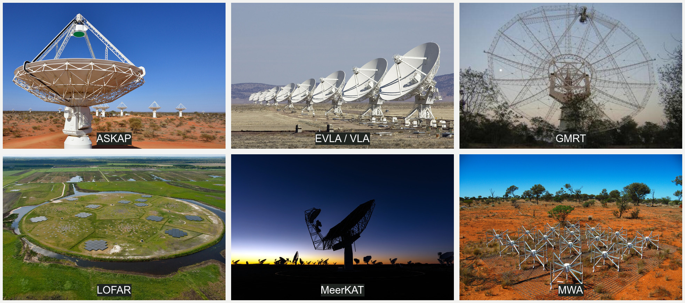
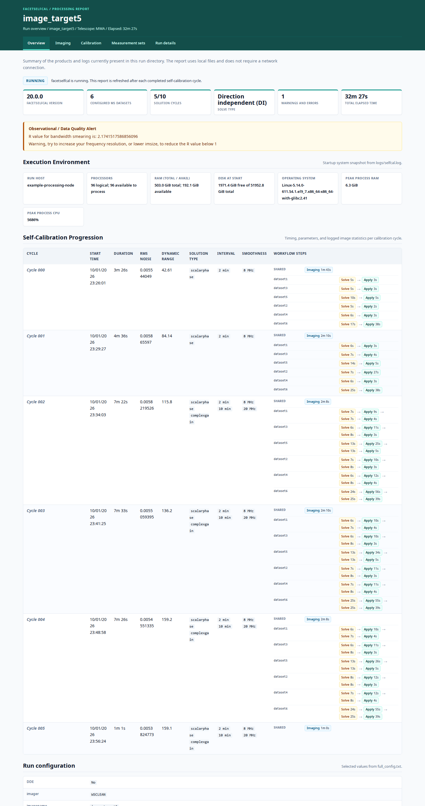
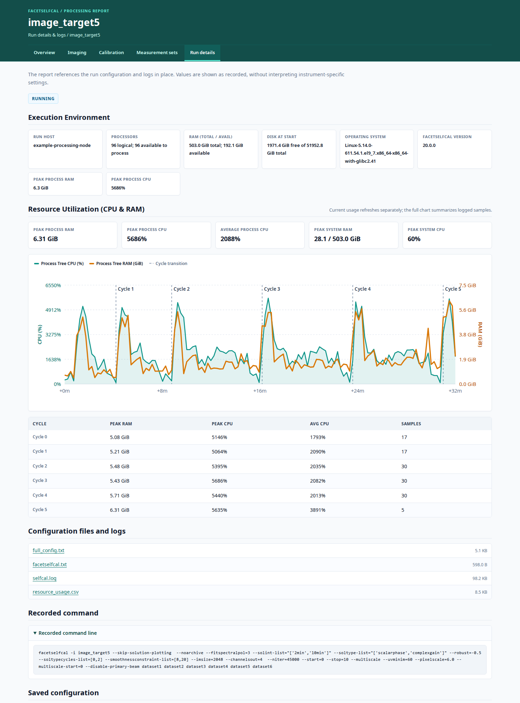

# facet self-calibration

`lofar_facet_selfcal`, or `facetselfcal` for short, is a command-line toolkit for direction-independent and direction-dependent (self-)calibration of radio-interferometric data. It supports calibration refinement of extracted datasets, full-field self-calibration, and extraction of regions of interest.

The workflows are used with data from LOFAR, MeerKAT, ASKAP, uGMRT, (E)VLA, and MWA observations. Processing details can vary by instrument and observing mode, so the instrument-specific notes below are a useful starting point.



*A selection of supported radio facilities. Image credits and licenses are listed in [`docs/assets/ATTRIBUTIONS.md`](docs/assets/ATTRIBUTIONS.md).*

## Capabilities

- Automated and configurable self-calibration cycles
- Direction-independent and direction-dependent calibration
- Full-field imaging and facet-based processing
- Extraction of regions of interest from larger fields
- HDF5 calibration-table utilities and diagnostic tools
- Support for LOFAR, MeerKAT, ASKAP, uGMRT, (E)VLA and MWA telescopes

## Installation

`facetselfcal` depends on a large radio astronomy software stack, including [WSClean](https://wsclean.readthedocs.io/), [DP3](https://dp3.readthedocs.io/), and specific Python libraries. Rather than installing these yourself, run `facetselfcal` inside the [FLoCs](https://tikk3r.github.io/flocs/) container, which provides everything it needs. Containers are run with [Apptainer](https://apptainer.org/docs/) or [SingularityCE](https://docs.sylabs.io/); `singularity` can be used in place of `apptainer` in the examples below.

You then have two options:

- **Use the version inside the container.** FLoCs ships a version of `facetselfcal`, so nothing else needs to be installed.
- **Use the latest version from GitHub.** Clone the repository once, and run `git pull` inside it later to update:

  ```bash
  git clone https://github.com/rvweeren/lofar_facet_selfcal.git /path/to/lofar_facet_selfcal
  ```

  Then call `facetselfcal.py` from the clone instead of the container's `facetselfcal` command. Python puts the directory of `facetselfcal.py` first on its import path, so the code from the clone is used, not the copy installed in the container.

The examples below assume you work from a shell inside the container. Start one with your data and the clone bind-mounted (`-B`) so the container can see them:

```bash
apptainer shell -B /path/to/data,/path/to/lofar_facet_selfcal flocs.sif
```

Check that it works with:

```bash
# version inside the container
facetselfcal --help

# latest version from GitHub
python /path/to/lofar_facet_selfcal/facetselfcal.py --help
```

## Quick start

For an extracted LOFAR dataset, run automatic calibration with an extraction region:

```bash
facetselfcal \
	--auto \
	--imsize 1600 \
	-b your-ds9-extract-box.reg \
	-i your-image-name \
	your-extracted.ms
```

To use the latest GitHub version, replace `facetselfcal` with `python /path/to/lofar_facet_selfcal/facetselfcal.py`:

```bash
python /path/to/lofar_facet_selfcal/facetselfcal.py \
	--auto \
	--imsize 1600 \
	-b your-ds9-extract-box.reg \
	-i your-image-name \
	your-extracted.ms
```

For a configuration-driven run:

```bash
facetselfcal --config your-config.txt your-extracted.ms
```

An example configuration is available at [`facetselfcal/data/example_config.txt`](facetselfcal/data/example_config.txt). Use `facetselfcal --help` to inspect all options.

You can also run a single command in the container without opening a shell, using `exec`. For example, with the latest GitHub version:

```bash
apptainer exec -B /path/to/data,/path/to/lofar_facet_selfcal flocs.sif \
	python /path/to/lofar_facet_selfcal/facetselfcal.py \
	--auto \
	--imsize 1600 \
	-b your-ds9-extract-box.reg \
	-i your-image-name \
	your-extracted.ms
```

## Typical workflow

1. Prepare a measurement set and, where needed, an extraction region.
2. Choose automatic settings or create a configuration file.
3. Run `facetselfcal` inside the appropriate FLoCs container.
4. Inspect the generated images, calibration tables, and diagnostics.
5. Use the supporting utilities for HDF5 tables, facet regions, source selection, or phase-difference analysis.

### Run-directory protection

Facetselfcal allows only one active run per working directory. It records the effective mode in `misc/facetselfcal_mode.txt` as `bandpass`, `DDE`, or `standard`; later runs in that directory must use the same mode. Use a new, clean run directory to change modes. Keep the marker with the run products; removing it alone does not make a mode change safe.

The [facet self-calibration overview](https://github.com/rvweeren/lofar_facet_selfcal/wiki/FACETSELFCAL-OVERVIEW) describes the extraction workflow in more detail.

## Instrument notes

### LOFAR

The package includes workflows for Dutch HBA and LBA baselines, international HBA baselines, wide-field processing, and decameter-band data. The exact settings depend on the observation and calibration strategy. See the [LOFAR HBA Dutch stations processing notes](https://github.com/rvweeren/lofar_facet_selfcal/wiki/LOFAR-HBA-Dutch-stations-processing) for instrument-specific guidance.

### MeerKAT

MeerKAT workflows cover UHF, L-band, and S-band data, including direction-independent and direction-dependent self-calibration. See the [MeerKAT processing notes](https://github.com/rvweeren/lofar_facet_selfcal/wiki/MeerKAT-processing).

### ASKAP

See the [ASKAP processing notes](https://github.com/rvweeren/lofar_facet_selfcal/wiki/ASKAP-processing) for instrument-specific guidance.

### uGMRT

See the [uGMRT processing notes](https://github.com/rvweeren/lofar_facet_selfcal/wiki/uGMRT-processing) for instrument-specific guidance.

### (E)VLA

See the [(E)VLA processing notes](https://github.com/rvweeren/lofar_facet_selfcal/wiki/VLA-processing) for instrument-specific guidance.

## Command-line tools

Installing the package provides these commands:

| Command | Purpose |
| --- | --- |
| `facetselfcal` | Run the main self-calibration workflow |
| `h5_merger` | Merge calibration HDF5 files |
| `ds9facetgenerator` | Generate facet regions for DS9 |
| `sub_sources_outside_region` | Extract a region from the LoTSS survey data |

### Offline HTML report

Each initialized `facetselfcal` run creates a multi-page offline report in `html_overview/` shortly after startup, prints the full `index.html` path in highlighted terminal text, refreshes the report after each completed self-calibration cycle, and records the final run status when processing ends.

To regenerate a report without rerunning calibration:

```bash
python -m facetselfcal.report /path/to/run --status completed
python -m facetselfcal.report /path/to/run --output /path/to/report-copy
```

Only specify `--status` when the outcome is known; regeneration otherwise reports an unknown outcome. Keep the run products available at their original relative locations for offline browsing. An alternative output directory still links to the source products; it is not a self-contained archive.


<table>
  <tr>
    <th width="50%">Overview</th>
    <th width="50%">Run details</th>
  </tr>
  <tr>
    <td valign="top" width="50%"></td>
    <td valign="top" width="50%"></td>
  </tr>
</table>

## Citation

If you use this software or its extraction workflows for scientific work, please cite:

- van Weeren et al. (2021), *A&A*, 651, A115: [ADS record](https://ui.adsabs.harvard.edu/abs/2021A%26A...651A.115V/abstract)
- `facetselfcal` version 19.6.3, DOI [10.1051/0004-6361/202039826](https://doi.org/10.1051/0004-6361/202039826)

The machine-readable citation is available in [`CITATION.cff`](CITATION.cff).

## Contributing and support

Bug reports, feature requests, and contributions are welcome through the [GitHub repository](https://github.com/rvweeren/lofar_facet_selfcal). Please include the instrument, relevant software or container version, command/configuration, and a concise description of the observed behavior when reporting an issue.
