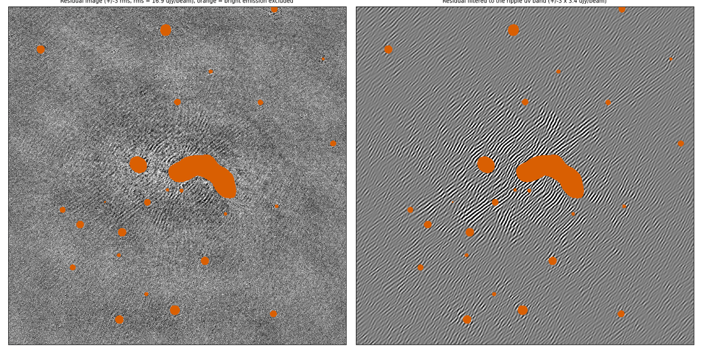
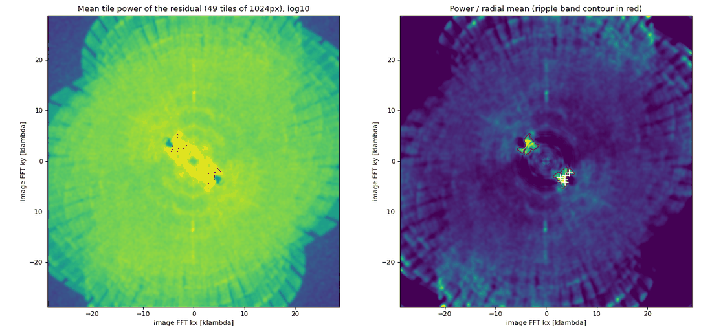
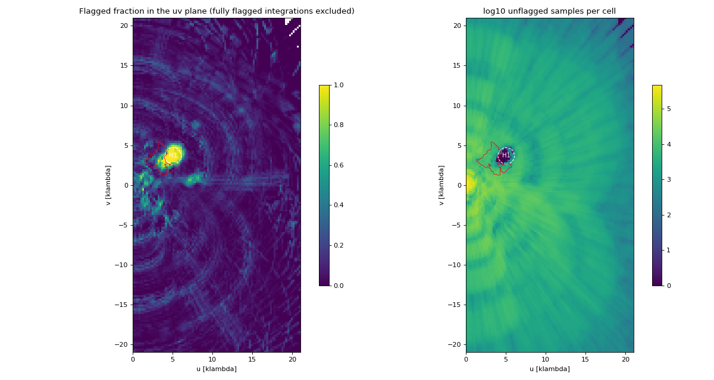
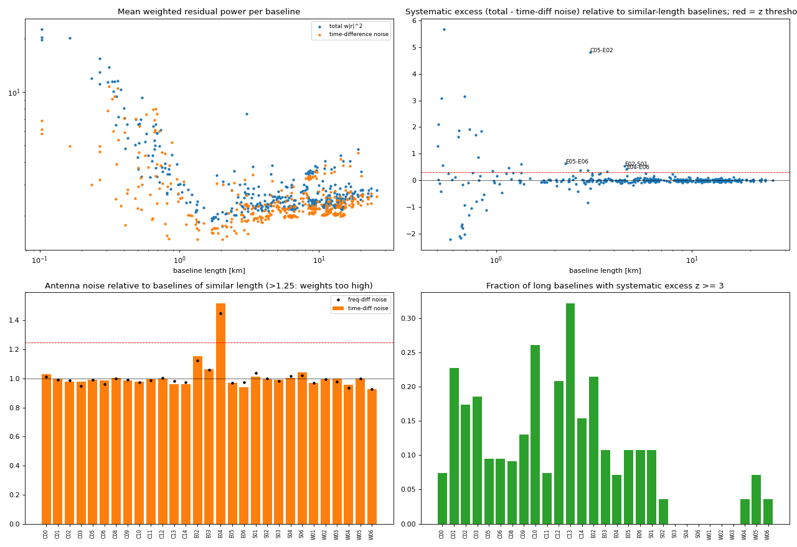
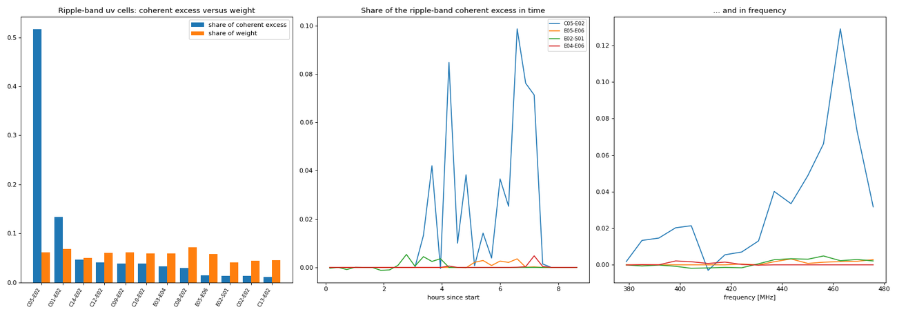
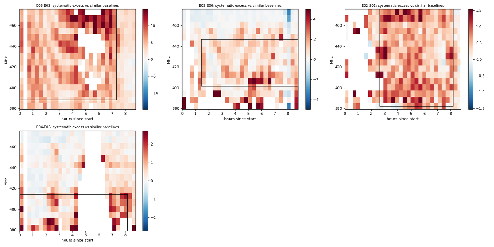
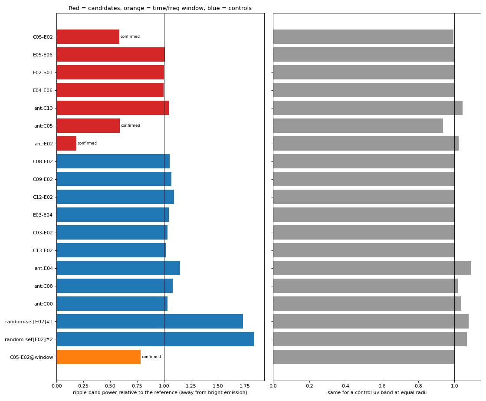
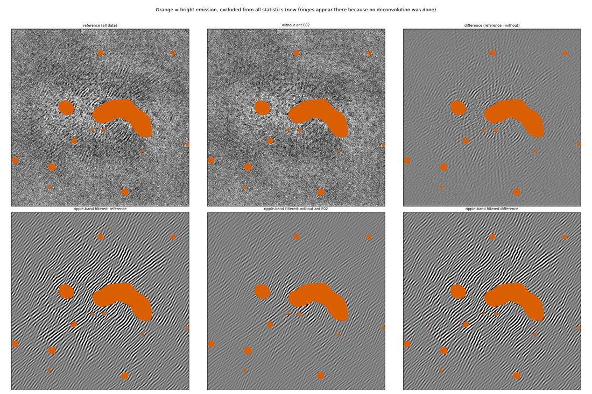

# `ripple_baseline_finder.py`: find the baselines/antennas that cause ripples and stripes

`submods/ripple_baseline_finder.py` helps to answer the question: *which baseline, antenna, time range or frequency range is responsible for the ripples/stripes that I see in the background of my (residual) image?*

It needs only three inputs:

1. a Measurement Set (MS) with a **residual data column** (data minus the model, for example `RESIDUAL_DATA`; a `MODEL_DATA` column is **not** needed),
2. the **MFS residual image** (FITS) made from that data,
3. the **MFS (clean) image** (FITS), which is used only to find the bright emission that must be ignored.

It writes a markdown report, a `results.json` file and a set of diagnostic figures. The report suggests actions (for example flagging a baseline), but the script never modifies your MS. It also re-images the residual data with WSClean, with the suspected baselines/antennas removed, to **confirm** its findings. The tool is not specific to one telescope: it was developed on uGMRT data (RR/LL) but works for XX/YY, RR/LL or Stokes I data (MeerKAT, LOFAR, VLA, ...).

Contents: [1. Quick start](#1-quick-start) · [2. Background](#2-background-why-does-a-bad-baseline-give-ripples) · [3. What the script does](#3-what-the-script-does-step-by-step) · [4. Output files and figures](#4-output-files-and-figures) · [5. The report, section by section](#5-the-report-section-by-section) · [6. How to decide what to do](#6-how-to-decide-what-to-do) · [7. Options](#7-command-line-options) · [8. Implementation details](#8-implementation-details) · [9. Run time, memory, disk](#9-run-time-memory-and-disk-space) · [10. Limitations and troubleshooting](#10-limitations-and-troubleshooting)

---

## 1. Quick start

```bash
python submods/ripple_baseline_finder.py obs.ms \
    --residual-image run-MFS-residual.fits \
    --image          run-MFS-image.fits \
    --data-column    RESIDUAL_DATA \
    --output-dir     ripple_report \
    --jobs 4
```

Within the LOFAR/facetselfcal singularity container use the wrapper in the repository, for example `./remote_singularity_python.sh submods/ripple_baseline_finder.py ...`. The python environment needs `numpy`, `scipy`, `matplotlib`, `astropy` and `python-casacore`; WSClean must be on the `PATH` (or be given with `--wsclean`, see below).

Then read `ripple_report/ripple_report.md` and look at the figures `01_...` to `08_...` (section 4). A typical flow is:

1. Check the summary (report section 1) and the **verification figure `07_verification_summary.png`**.
2. Look at the `08_compare_*.png` figures of the confirmed candidates: is the stripe pattern in the filtered image really weaker *away from the orange (masked) bright emission*?
3. Decide what to flag (section 6) and re-image/self-calibrate.

Useful variants:

```bash
# statistics only, no WSClean runs (fast, a few minutes for a 9 GB MS)
... --no-wsclean

# also test baselines or antennas of your own choice
... --extra-baselines C05-E02,E03-E04 --extra-antennas E04

# WSClean in a container, or with a different executable
... --wsclean "singularity exec /path/to/image.sif wsclean"

# user supplied WSClean imaging options instead of the ones found in the FITS header
... --wsclean-args "-size 4000 4000 -scale 1.5arcsec -weight briggs -0.5 -minuv-l 50 -join-channels -channels-out 4"
```

An example output (GMRT band 3 observation of 3C129) is shown in the figures below and stored in [ripple_baseline_finder_example/](ripple_baseline_finder_example).

---

## 2. Background: why does a bad baseline give ripples?

A single bad *baseline* (or antenna) contributes visibilities along a track in the uv plane. An error `e(u, v)` on those visibilities Fourier-transforms into a pattern on the sky. If the error is concentrated in a small range of `|uv|` it becomes a **sinusoidal ripple** with:

- a wavelength `lambda = 1 / |uv|` (a ripple at `|uv|` = 5 klambda has a period of about 41 arcsec),
- stripes perpendicular to the direction of the `(u, v)` vector,
- an amplitude that scales with the flux of the structure the error is multiplied with, which is why the ripples are strongest around bright sources and fall off with distance.

The script uses this in two directions:

- **From the image to the uv plane:** the Fourier transform of the residual image shows at which `(u, v)` the ripple power sits (the *ripple band*). Only visibilities that fall in that band can have caused the ripple.
- **From the visibilities to the image:** baselines whose residuals are anomalous *and* which contribute to the ripple band are candidates. Removing a candidate from the data and re-imaging shows whether the ripple really goes away.

There is a second, very different cause that the script also checks for: **a hole in the uv coverage** (a compact region where almost all data were flagged). The PSF sidelobes of a hole next to strongly structured emission appear as ripples as well, with no bad baseline at all. For this reason the report always lists the flagged uv holes next to the ripple band.

Keep in mind that a residual contains much more than antenna errors: unmodelled sky structure, calibration errors of the direction-dependent kind, noise, and PSF effects of the imaging itself. The script therefore only *proposes* candidates from statistics and then tests them with images.

---

## 3. What the script does, step by step

### Step 1: read the images, mask bright emission

- The residual rms is estimated robustly (1.4826 x the median absolute deviation, MAD).
- Bright emission is taken from the **clean image**: the image is smoothed with a Gaussian of one beam, and pixels above `--bright-sigma` times the residual rms (default 50) or above `--bright-threshold` (Jy/beam) are marked bright. For the *evaluation* a margin (`--bright-margin-arcsec`, default 100") is added around it.
- Why: after you remove a baseline and image *without deconvolution*, new fringes appear on top of every bright source (their sidelobes are no longer cleaned). This is expected and says nothing about the ripples. **All statistics are therefore measured only outside the bright-emission mask**, and the mask is shown in orange in the figures.

### Step 2: find the ripple band in the residual image

1. Bright pixels are zeroed, a Gaussian high-pass (`--highpass-arcsec`, default 50") removes large-scale structure, and |pixel| > 5 rms is clipped to zero (remaining sources).
2. The image is cut into overlapping tiles (`--tile-size`, default 1024 px, shrunk for small images). Tiles with too much masked area are skipped (the validity limit relaxes 70%, 50%, 30% until at least 4 tiles are found). Every tile is multiplied by a Hann window, Fourier transformed, and the power spectra are **averaged**. Averaging suppresses random structure and noise and keeps what is coherent over the image: the ripple.
3. The averaged spectrum is **whitened**: divided by its azimuthal (radial) mean. A ripple shows as a compact region with whitened power above `--band-threshold` (default 2.0, so 2x the radial mean).
4. Connected regions of at least `--band-min-cells` FFT cells are kept (and only components with at least 10% of the strongest component's excess). The union is the **ripple band**. The search is restricted to `|uv|` between `--band-uv-min` (default 6 FFT cells, to skip large scales) and `--band-uv-max` (default: min(maximum uv of the data, Nyquist/4)).
5. The strongest peaks (at most six, distinct) are converted to uv coordinates, ripple wavelength, wave-normal position angle (PA) and **stripe PA** (the stripes run perpendicular to the wave normal; PA from north through east).

The mapping from the image FFT axes `(kx, ky)` to the MS `(u, v)` follows the FITS axes (`u = -kx` for the usual RA axis that increases to the left, `v = +ky`). If every test later shows no effect at all you can try `--uv-sign flip` (see troubleshooting).

### Step 3: scan the Measurement Set (one pass over the data)

For each row the residual of the parallel hands is combined into one visibility per channel: the weight-averaged `r = sum(w_p r_p) / sum(w_p)` with total weight `w = sum(w_p)`. RR/LL (or XX/YY) or Stokes I are recognised from the `POLARIZATION` table; cross-hands are ignored. The weights come from `WEIGHT_SPECTRUM` (or `WEIGHT`; `--weight-column none` gives unit weights). Flagged samples, NaN and zero weights are excluded. Channels are averaged to at most about 128 (`--chan-avg`), and all `DATA_DESC_ID`s with the same channel count are processed. Statistics are accumulated in blocks of `--time-blocks` (default 30) x `--freq-blocks` (default 16) per baseline.

During the single pass the following things are computed:

**(a) Noise and total power per baseline, from differences.** For each baseline and neighbouring integrations `t, t+1` (and neighbouring channels):

- *total power*: `0.5 (w1 |r1|^2 + w2 |r2|^2)`,
- *noise estimate*: `0.5 min(w1, w2) |r1 - r2|^2`.

Smooth, systematic errors (the ones that cause ripples) are almost identical in neighbouring samples and cancel in the difference, whereas thermal noise doubles. So `total - noise` is the **systematic excess**. All terms are clipped at `--clip-factor` (default 13) times the median `w|r|^2` so that a few outliers (RFI, bright sources) do not dominate. Time differences are only formed between truly consecutive integrations (and only when `TIME` is monotonic).

**(b) The uv flag map.** All samples (flagged or not) are binned in a coarse uv grid (cells of 2.5 x the fine cell, about 240 lambda for a 4320 px / 1.25" image). The flagged fraction and the number of samples per cell, and, per antenna, the flagged counts, are kept. Rows that are completely flagged are left out of these counts, so that fully flagged integrations do not make the whole plane look flagged. Samples are folded into `u >= 0` (the visibility at `-uv` is the complex conjugate).

**(c) Samples in the ripple band.** Samples (baseline, time slot, channel, weight, visibility) that fall in uv cells of the ripple band on a fine uv grid (`--uv-cell`, default `2.5 / field of view`) are stored (up to `--max-ripple-samples`). They are used in the attribution of step 4.

### Step 4: analyse

**Baseline outliers.** For every baseline longer than `--min-baseline-length` (default 500 m) the systematic excess is compared with the median of the 31 baselines closest in length (the residual power depends strongly on baseline length, which would otherwise put all short core baselines at the top). The remainder is converted to a robust z score (using the MAD of all baselines with a floor of 2% of the typical power). This is the statistic called `z` in the report; `--z-threshold` (default 6) selects outliers.

**Antenna noise.** For every antenna the median over its baselines of (time-difference noise / noise expected from similar-length baselines) is reported as `noise_rel` (1.0 is normal). `frac_out` is the fraction of its long baselines with z >= 3. An antenna with `noise_rel` > 1.25 is reported as a noisy antenna: its weights are too high (the data are noisier than the weights say). That does **not** create ripples; it needs *reweighting*, not flagging.

**Ripple-band attribution.** In every uv cell of the ripple band, the weighted visibilities of all samples add *coherently* (a ripple means that many different baselines/times in the same uv cell see the same signal). For each sample a coherent contribution `a = Re( w r  *  conj(sum_other w r) )` is computed, where the sum runs over all *other* samples in the cell (so noise, which is uncorrelated between samples, cancels on average). Summing `a` per baseline and dividing by the total gives its **share of the coherent excess**, to be compared with its **share of the weight** (how many samples it contributes there). The ratio of the two (ratio > 1) says that this baseline carries more of the ripple than its sampling explains. The same is done per antenna, with the coherent power per unit weight^2 of samples involving the antenna compared to those that do not (`q_in`, `q_out` in `results.json`).

**uv holes.** Regions where > 90% of the samples are flagged, with at least 20% of the median sample count per cell and at least 4 coarse cells, are found with connected-component labelling. For every hole the centre, radius, flagged fraction, the main antennas involved (share of the flagged samples), and the distance to the ripple band are given. A hole is called *adjacent* if it is closer than 1.5 radii + 2 cells.

**Time/frequency windows.** For each candidate baseline two windows are derived: (i) where its systematic excess (relative to similar-length baselines) is concentrated in the time-frequency plane (blocks above 50% of the maximum, in time and in frequency), and (ii) where its contribution to the ripple-band coherent excess sits (blocks above 30% of the maximum). A window is called *localized* if it contains at least 60% of the signal and fills at most 60% (i) or 50% (ii) of the time-frequency plane.

### Step 5: choose the candidates and the controls

**Candidate baselines** (at most `--max-baseline-candidates`, default 4, best score first) must fulfil at least one of

- (a) systematic-excess z >= `--z-threshold`, excess >= 15% of the typical power, *and* at least 0.2% of the ripple-band weight (a baseline that does not contribute to the band cannot have caused the ripple),
- (b) at least 3% of the ripple-band coherent excess *and* a coherent-excess/weight ratio of at least 3.

If fewer than two baselines qualify, the two weakest-evidence ones are tested anyway (noted in the report). Baselines given with `--extra-baselines` are always added.

**Candidate antennas** (at most `--max-antenna-candidates`, default 2): antennas where at least 30% of the long baselines have z >= 3 and which hold at least 1% of the ripple-band weight. Antennas from `--extra-antennas` are added.

**Antennas of a clearly bad baseline.** If a candidate baseline passes *both* criteria (a systematic-excess outlier **and** a large coherent-excess share in the ripple band; at most the two best such baselines), its two antennas are also added as antenna candidates (`ant:C05`, `ant:E02` for the baseline C05-E02), unless `--no-baseline-antennas` is given. This answers the question whether the problem is specific to the baseline or an antenna-wide problem: if an antenna appears in many of the baselines that feed the ripple band (as E02 does in the example), flagging only the baseline might not be enough. The comparison is made in the report (see the verdict below).

**Weight-matched random controls for heavy antennas.** An antenna that is involved in a large fraction (>= 15%) of the ripple-band samples (E02 is in about 74% of them in the example) cannot be judged against ordinary control antennas: removing it removes most of the *data* in the ripple band, which changes the ripple power through the uv coverage alone. For every such antenna two extra controls are therefore made: **random sets of baselines** (drawn from all baselines that have ripple-band samples, except the candidate baselines, with a fixed random seed per set) that together carry the same fraction of the ripple-band weight. They appear as `random-set[ANT]#1` and `#2` in the report and in figure 07, and they are the only reference for the antenna verdict.

**Control baselines/antennas** (`--n-controls` = 6, `--n-antenna-controls` = 3): baselines that carry weight in the ripple band, are *not* outliers (z < half the threshold), and preferably have a similar length as the candidates (0.5-2 x). Control antennas have no outliers (`frac_out` < 10%) and are sorted by ripple-band weight. Controls show what happens when an *ordinary* baseline with a similar amount of data in the ripple band is removed. This is the essential reference for judging the effect of a candidate. It is not enough that the ripple power drops when a candidate is removed, because removing any data changes the PSF and thus the ripple pattern.

**Window variant:** for the top candidate, if one of its windows is localized, one more image is made in which only the data within that time/frequency window are flagged.

### Step 6: confirm with WSClean

For every variant (reference, candidates, controls, window) the residual column is imaged without deconvolution.

- **Options.** The imaging options are taken from the `HISTORY` of the clean image's FITS header (the WSClean command that made it), or the residual image's if not found there, or a minimal default (size and scale from the header, `-weight briggs 0 -pol i -gridder wgridder`). They are **sanitised**: all deconvolution options (`-niter`, `-nmiter`, `-mgain`, `-auto-mask`, `-auto-threshold`, `-multiscale*`, `-fits-mask`, `-local-rms*`, `-parallel-deconvolution`, ...), all facet/direction-dependent options (`-facet-regions`, `-apply-facet-solutions`, `-apply-facet-beam`, `-diagonal-visibilities`, ...) and the data column, name, temp-dir, thread and MS arguments are removed. `-niter 0`, `-data-column <your column>` and a unique `-name` are added. Size, scale, weighting, `-minuv-l`, `-join-channels`, `-channels-out` and the gridder are kept, so the images are comparable with your original residual image. If you give `--wsclean-args` these replace the HISTORY options (same sanitising).
- **Working MS.** A deep copy of the MS is made in the work directory (`--work-dir`, default `<output-dir>/work`; other complex columns than the residual column are dropped to save space). For each variant the `FLAG` of the selected rows (baseline, or antenna, optionally limited to a time and channel range) is set to True in the **copy**, WSClean is run, and the flags are restored. The input MS is never touched.
- **Concurrency.** With `--jobs N` (default 1), N workers each with their own MS copy run in parallel. The workers are fresh Python processes (not forks, see section 10).

Metric. For every image the residual is high-passed and clipped as in step 2, and filtered with the ripple band (and with a **control band**: the same radii in |uv| but outside the ripple band). The rms of the band-filtered image is measured **outside the bright-emission mask only**. The *band power ratio* is `(rms_variant / rms_reference)^2`, and the same for the control band. The control-band ratio tells whether the removal changed things at other uv ranges too (a baseline with many samples changes the noise and the PSF everywhere; ratios near 1 mean the effect is specific to the ripple band).

Verdict for each candidate (or window) with ratio `r`, using the controls pool (baseline candidates are compared with the control baselines; antenna candidates with the control antennas if there are at least two):

| condition | verdict |
|---|---|
| `r` <= 0.85 and `r` <= (lowest control ratio - 0.05) (with at least 3 controls; otherwise `r` <= 0.7) | **CONFIRMED** |
| `r` <= 0.9 | partial effect, not clearly above controls |
| `r` >= 1.1 | removal increases ripple power (the data partly cancel the ripple) |
| otherwise | no significant effect |

For an antenna with weight-matched random controls the verdict uses those controls only (`r` <= 0.85 and at least 0.05 below the lowest random-set ratio); if the drop is as large as for random removal of the same weight, the report calls it a *coverage effect* and does not blame the antenna.

For an **antenna that was tested because of a bad baseline** the ratio is also compared with that of the baseline alone. If removing the whole antenna does not reduce the ripple power more than removing only the baseline (the antenna ratio is not more than 0.10 below the baseline ratio), the problem is called *baseline-specific*: the report then recommends flagging the baseline only, and does not recommend flagging the antenna even if the antenna removal is also "confirmed" (it contains the bad baseline). If the antenna removal is clearly stronger and also beats its controls, it is reported as an antenna-wide contribution; if it is stronger than the baseline alone but not more than the weight-matched random removal, the conclusion is "inconclusive (coverage effect)". When a confirmed antenna is involved in a large fraction (>= 15%) of the ripple-band samples, the suggested action carries a **caution**: its baselines populate the ripple uv region, so the ripple may be carried by them because of the uv coverage (for example next to a flagged hole) rather than by an antenna error; the report then also lists the effect of removing single non-outlier baselines of that antenna. In the 3C129 example removing the whole antenna E02 lowers the ripple-band power to 0.18 (the baseline C05-E02 alone: 0.58), whereas random removal of the same ripple-band weight *raises* it (1.7-1.8) and single non-outlier E02 baselines give 1.02-1.09. The drop is therefore not a coverage effect: **E02 is identified as a bad antenna, in addition to the bad baseline C05-E02**, and the report recommends flagging both (with the caution that E02 is in 74% of the ripple-band samples, so check its calibration solutions). Keep in mind that removing an antenna removes all its other baselines as well, which changes the PSF and the uv coverage (an antenna with a large share of the ripple-band weight, like E02 in the example, can change the ripple purely through that), so the control antennas, or for a heavy antenna the weight-matched random sets, are the reference for this test.

The median and the spread (robust sigma) of the controls and the resulting z are also reported.

---

## 4. Output files and figures

All files are written to `--output-dir` (default `ripple_report`). A non-empty directory requires `--overwrite`. The work directory (`<output-dir>/work`) is removed at the end unless `--keep-work` or an explicit `--work-dir` is given.

| file | content |
|---|---|
| `ripple_report.md` | the report (section 5) |
| `results.json` | all numbers behind the report: ripple peaks, band, holes, candidate and control baselines (z, shares, ratios), WSClean metrics and verdicts, noisy antennas, windows |
| `01_residual_overview.png` | the residual image and its ripple-band filtered version |
| `02_ripple_spectrum.png` | power spectrum of the residual and the detected ripple band |
| `03_uv_flags.png` | uv-plane flag map, sample density, detected holes and the ripple band |
| `04_baseline_stats.png` | baseline power, systematic excess, antenna noise, outlier fraction |
| `05_ripple_attribution.png` | which baselines/times/frequencies feed the ripple band |
| `06_timefreq_candidates.png` | time-frequency maps of the candidates' systematic excess |
| `07_verification_summary.png` | the WSClean test result: band power of all variants |
| `08_compare_<variant>.png` | image comparison for every candidate, the window variant and two controls |

The figures below are from the 3C129 example (GMRT, 29 antennas, 2944 integrations, 352 channels). In this data set the ripples are caused by the baseline C05-E02 and, beyond that baseline, by the antenna E02 (the antenna C05 is not involved beyond the baseline).

### `01_residual_overview.png`



*Left:* the residual image (displayed at +/-3 rms), with the bright-emission mask in **orange**. *Right:* the same image filtered to the ripple uv band found in step 2 (+/-3 times its own rms).

What to look for: the right panel should show clear, regular stripes (a coherent wave pattern) with one dominant orientation and wavelength, strongest around the bright source and fading outward. If the right panel shows only random blobs, the "ripple" is not a narrow-band feature and this tool is not appropriate (or lower `--band-threshold`). Check that the stripe orientation matches what you see in the residual image yourself. The orange areas are excluded from all numbers.

### `02_ripple_spectrum.png`



*Left:* tile-averaged power spectrum of the residual (log10), axes are the image FFT coordinates `kx, ky` in klambda; the radial scale is that of the uv plane. *Right:* the same divided by its radial mean (the whitened power), with the ripple band outlined in red and the strongest peaks marked with white crosses.

What to look for: a compact, bright, symmetric (point-reflected through the origin) island in the right panel marks the ripple. A dark hole next to it (low power, as in the example) is a hint for missing uv data (see figure 03). A narrow vertical or horizontal line through the centre can be an edge or RFI effect and is normally not relevant. Faint structure at very large `|uv|` is usually an imaging/tiling effect.

### `03_uv_flags.png`



*Left:* fraction of flagged samples per uv cell (half plane, `u >= 0`). *Right:* log10 number of unflagged samples per cell. The red contour is the ripple band, white dashed circles with labels `H1`, `H2`, ... are the detected holes (> 90% flagged).

What to look for: a **hole next to or inside the red contour** is a prime suspect for ripples that no bad baseline can explain; the report lists the antennas that supply most of the flagged samples of each hole (section 3 of the report). Ask why these data were flagged (for instance an automatic flagger that treats strong, structured source signal as RFI) and re-image with them restored. The ring-like and streaky structure in the left panel follows the uv tracks of the array and is normal.

### `04_baseline_stats.png`



Four panels:

- *Top left:* the mean weighted residual power `w|r|^2` per baseline (blue) and its noise estimate from time differences (orange) against baseline length (log-log). Short baselines are higher (unmodelled extended emission), long baselines should flatten to the noise level. This is why the outlier search compares with baselines of similar length.
- *Top right:* the systematic excess (total - noise) relative to similar-length baselines versus baseline length. Most baselines scatter around zero; the dashed red line is the z threshold. Baselines above it are labelled (the candidates). One isolated point far above the cloud (as C05-E02 at 3 km in the example) is the classic signature of a bad baseline.
- *Bottom left:* the noise of every antenna relative to similar baselines (orange bars from time differences, black dots from frequency differences). Above the dashed line at 1.25 the antenna is noisier than its weights imply (E04 in the example, 1.5x). Both time and frequency estimates agree if the extra noise is white.
- *Bottom right:* for every antenna the fraction of its long baselines with a systematic excess z >= 3. An antenna with *all* its baselines elevated (a tall bar) points to an antenna-based problem; one bad baseline raises two bars slightly.

### `05_ripple_attribution.png`



*Left:* for the baselines with the largest share, the share of the ripple-band **coherent excess** (blue) and the share of the **weight** (orange). *Middle and right:* for each candidate, how its share of the coherent excess is distributed over **time** (hours since the start) and **frequency**.

What to look for: a baseline whose blue bar is far above its orange bar carries much more of the ripple than its amount of data justifies (C05-E02: 52% of the coherent excess with 6% of the weight). Baselines with similar blue and orange bars are only there because of the uv coverage. The time/frequency curves show *when and where* the baseline is bad; note that these are partly dictated by the uv coverage, since time and frequency determine which uv cell a sample falls in. A curve concentrated in a narrow time or frequency range suggests that flagging only that range may be enough.

### `06_timefreq_candidates.png`



One panel per candidate baseline: the systematic excess (total power minus time-difference noise, minus the value of baselines of similar length) in the time-frequency plane. Red is an excess, blue a deficit, white means no data (flagged). The black rectangle is the window (blocks above 50% of the maximum).

What to look for: a bad baseline can be bad everywhere (an entire panel red, as for C05-E02 in the example, where the excess is present over the whole run but strongest in a part of the time and band), or only in a patch (a clear, compact red area: flag that patch). Vertical stripes are single bad time slots, horizontal stripes bad channels (RFI-like and shared with other baselines, normally not baseline-specific).

### `07_verification_summary.png`



*Left:* the ripple-band power of the image **without** each variant, relative to the reference image with all data. Red bars are candidates (and `ant:NAME` antennas), orange bars the time/frequency-window variants, blue bars controls. A bar below 1 means weaker ripples. "confirmed" is written next to the bars that satisfy the criteria of step 6. *Right:* the same for the control band (same radii, outside the ripple band).

What to look for: a candidate that sits **clearly below all the blue bars** (here C05-E02: 0.58 against 1.02-1.09 for the control baselines and 1.03-1.15 for the control antennas), while its right-panel bar is close to 1, is convincing. Its time/frequency window variant (orange, 0.78) shows that part of the effect remains when only the window is flagged. Controls typically scatter a few per cent above 1; removing an ordinary baseline can even increase the ripple (it was cancelling part of it). If all candidates are in the same range as the controls, the ripples do **not** originate from a single baseline or antenna (look at the uv hole, the calibration or the model).

Two further things are visible in this example. `ant:C05` (0.59) is no stronger than the baseline C05-E02 alone (0.58): the problem is baseline-specific. `ant:E02` (0.18) is far below everything else and clearly stronger than the baseline alone, and the two `random-set[E02]` controls with the same ripple-band weight *increase* the power (1.7-1.8): E02 is a bad antenna, not just the partner of a bad baseline. Because E02 is in 74% of the ripple-band samples the report adds a caution (check its calibration solutions before flagging it).

### `08_compare_<variant>.png`


*(example: the baseline C05-E02)*



*(example: the whole antenna E02. Nearly the whole ripple pattern disappears, more than for the baseline C05-E02 alone.)*

One figure per candidate (and the window variant, plus the first two controls for comparison), cropped to the central part of the field (`--crop-fraction`, default 0.6). Top row: the reference dirty residual image (all data), the image without the variant, and their difference, all displayed at +/-3 rms. Bottom row: the same three images after filtering with the ripple band (scaled to the rms of the reference). Orange = excluded bright emission.

What to look for:

- Bottom row, left versus middle: are the stripes visibly weaker, or changed only in the neighbourhood of the bright sources (new fringes there are expected and ignored)? The numbers of the report come from the region outside the orange mask.
- The difference (right column) shows the pattern *caused* by the removed data. For a real culprit it is a clean wave with the same wavelength and orientation as the ripple in the reference image. A difference that does not resemble the ripple means the removal changed something else.
- Compare with the controls' figures: if a control's difference looks the same as the candidate's, the effect is not specific.

### What the report itself contains

See the next section.

---

## 5. The report, section by section

`ripple_report.md` is a plain markdown file that can be read as is.

1. **Summary.** The confirmed candidates with their band-power ratio (and the controls' median, spread and z), any notes (for example that weak candidates were tested), and the largest flagged uv hole, marked if it is adjacent to the ripple band. If nothing is confirmed this says so explicitly.
2. **The ripple in the residual image.** The band limits, the detected `|uv|` range, the table of peaks: `u`, `v` (klambda), wavelength (arcsec), wave-normal PA, **stripe PA** and whitened power. Use it to check that the pattern found is the one you see in your image.
3. **Flagged holes in the uv plane.** Centre, radius, flagged fraction, distance to the band and the antennas that supply the flagged samples of each hole. A hole built from many baselines to the same antenna(s) tells where to look in the flagging history.
4. **Baseline and antenna statistics.** The table of baselines (tested candidates first, then the highest z): length, total power, time- and frequency-difference noise, systematic excess, z, share of ripple-band weight, share of the coherent excess and their ratio. Baselines with "0.0%" ripple-band weight are shown for information only (they cannot cause the ripple). Then the list of **noisy antennas** (noise > 1.25 times the weights).
5. **Baselines feeding the ripple band.** Weight share versus coherent-excess share of the top ten baselines, and the antennas with the largest weight in the band (a large weight share only reflects the uv coverage).
6. **Time and frequency ranges.** For each candidate the two windows (systematic excess and ripple-band excess): time range (UT), frequency range (MHz), the fraction of the signal captured, the fraction of the time-frequency plane covered and whether it is localized.
7. **WSClean confirmation.** The imaging options used (and where they came from), the definition of the metric and the exclusion mask (threshold, margin, percentage of the image excluded), and the table of all variants: role, band-power ratio, control-band ratio and verdict. When the antennas of a bad baseline were tested, a second table compares the baseline alone with the removal of each of its antennas and the control antennas (conclusion: baseline-specific or antenna-wide contribution).
8. **Suggested actions.** For every confirmed baseline or antenna the ready-to-use TaQL command to flag it completely (written **for you to run yourself**), and, when a localized window was found, the TaQL command for the time window and a DP3 `preflagger` line with the frequency range. Also reweighting advice for noisy antennas (weights x about 1/noise_rel), and a reminder to investigate an adjacent uv hole. Always check the TaQL/DP3 syntax against your version, and **make a backup of your flags or the MS** before applying anything.
9. **Caveats.** The short list of limitations (section 10).

---

## 6. How to decide what to do

| What the report/figures show | Interpretation | Suggested action |
|---|---|---|
| One baseline confirmed (ratio well below the controls, figure 07), z far above the cloud in 04, high coherent-excess share in 05 | A bad baseline | Flag it (completely or the localized window if the window variant was also confirmed), re-image/self-calibrate, check that the ripple went down also in a *cleaned* image |
| Window variant confirmed with a ratio close to that of the full baseline | The problem is localized in time/frequency | Flag only the window: less data lost |
| An antenna (`ant:NAME`) confirmed and clearly stronger than its bad baseline alone (the report says "antenna-wide contribution"; E02 in the example), or all baselines of one antenna elevated in the bottom-right panel of 04 | An antenna problem (in addition to a bad baseline, if there is one) | Flag the bad baseline first, and check the calibration solutions of the antenna; flag the antenna (in that time/frequency range, if localized) if they are bad. If the antenna is in a large share (>= 15%) of the ripple-band samples, flagging it removes much data: check the effect on a cleaned image |
| Antenna noise > 1.25 (04 bottom left) but not confirmed | White noise higher than the weights say; does not cause ripples | Reweight (for instance with the noise from time differences), do not flag |
| Nothing confirmed, all candidates like the controls | Not a single-baseline problem | Look at the uv hole, the model/deconvolution, direction-dependent calibration or several baselines together (`--extra-baselines` to test sets one at a time) |
| A flagged hole adjacent to the ripple band | Missing uv data on strong structured emission | Find out why it was flagged and restore the data (or flag more carefully); re-image |
| Candidates have ratios < 1 only slightly below the controls ("partial effect") | Weak or distributed contribution | Inspect the comparison figures, test the effect on a cleaned image, consider flagging only if it is cheap |

Remember that the test is made on **dirty (not deconvolved) images of the residual column**. After flagging, always re-image and self-calibrate (or at least re-run a clean) before drawing conclusions about science images. Flagging a baseline that carries 5% of the data in a critical uv range can cost sensitivity: weigh this against the gain.

---

## 7. Command-line options

Run `python submods/ripple_baseline_finder.py -h` for the full list with defaults. Summary:

**Input/output**

| option | default | meaning |
|---|---|---|
| `ms` | | Measurement Set with the residual column |
| `--residual-image` | required | MFS residual FITS image |
| `--image` | required | MFS (clean) FITS image; used for the bright-emission mask and for the WSClean command in its header |
| `--data-column` | `RESIDUAL_DATA` | residual visibility column |
| `--weight-column` | `auto` | `WEIGHT_SPECTRUM`, `WEIGHT`, `none` (unit weights) or `auto` (first available of the first two) |
| `--output-dir` | `ripple_report` | output directory |
| `--work-dir` | `<output-dir>/work` | working MS copy and WSClean products |
| `--field-id` | most rows | FIELD_ID to analyse |
| `--overwrite` | off | allow a non-empty output directory |

**Bright-emission mask:** `--bright-sigma` (50), `--bright-threshold` (Jy/beam, overrides sigma), `--bright-margin-arcsec` (100).

**Ripple band:** `--highpass-arcsec` (50), `--tile-size` (1024), `--band-threshold` (2.0), `--band-uv-min`, `--band-uv-max` (lambda), `--band-min-cells` (12), `--uv-sign` (`wcs`, or `flip`).

**Visibility analysis:** `--chan-avg` (auto: at most ~128 channels), `--uv-cell` (2.5 / field of view, lambda), `--time-blocks` (30), `--freq-blocks` (16), `--min-baseline-length` (500 m), `--z-threshold` (6), `--clip-factor` (13), `--chunk-elements` (1.5e7, memory per read), `--max-ripple-samples` (2e8).

**WSClean confirmation:** `--no-wsclean`, `--wsclean` (command, may contain a prefix such as `singularity exec x.sif wsclean`), `--wsclean-args`, `--wsclean-threads` (WSClean `-j`), `--jobs` (concurrent WSClean runs, one MS copy each), `--max-baseline-candidates` (4), `--max-antenna-candidates` (2), `--no-baseline-antennas`, `--n-controls` (6), `--n-antenna-controls` (3), `--extra-baselines` (`A-B,C-D`), `--extra-antennas`, `--no-window-test`, `--keep-work`, `--crop-fraction` (0.6).

---

## 8. Implementation details

The script is a single file, organised in the following blocks (function names in parentheses).

**Image helpers.** `read_image` reads a FITS image (2-D cut of 4-D cubes); `ImageInfo` stores pixel size, axis signs (`su`, `sv`), beam size in pixels and field of view; `make_bright_masks` creates the masks (`zero` = bright pixels dilated by 3 pixels, zeroed before filtering; `exclude` = bright pixels blurred by half the margin, thresholded at 0.02; the evaluation region is `~exclude`); `prepare_residual` does the high-pass and clipping; `tile_power`, `radial_mean` and `detect_band` find the ripple band (class `RippleBand`); `fft_masks` maps the band (and the control band, the same annulus without the band) to the full-image FFT grid, smoothed with a Gaussian of 2 cells; `band_filter` and `band_power` filter an image with these masks and measure the rms in the evaluation region.

**MS scan (`scan_ms`).** One streaming pass over the selected field (`ms_overview`; cross-correlations only), in chunks of `--chunk-elements` visibility elements. `ddid_info` selects the parallel-hand correlations and the channel frequencies of each `DATA_DESC_ID`; `read_visibility_chunk` returns the weight-averaged residual and the total weight per channel with flags/NaN/zero weight excluded, `average_channels` averages channels. Per baseline, statistics are accumulated in arrays of shape `(baselines, time blocks, frequency blocks)`. The uv coordinates are `u = u_m f / c`, folded into `u >= 0`. The data clip level is estimated from a small spread-out subsample before the pass. The fine uv grid for the ripple-band samples (`--uv-cell`) and the coarse flag grid (2.5 x) are two separate grids.

**Analysis.** `baseline_table` (systematic excess, `length_median` over 31 nearest baselines in length, robust z), `antenna_table`, `ripple_attribution` (coherent excess; implemented with `np.bincount` over cells), `time_freq_marginals`, `excess_window` and `ripple_window` (windows), `find_holes` (connected components with `scipy.ndimage.label`), `select_candidates` (candidates, controls).

**WSClean confirmation.** `sanitize_wsclean_command` removes deconvolution/facet options with their argument counts (`_DROP_ARGS`); `wsclean_base_options` chooses the source of the options; `prepare_work_ms` makes the deep copy; `run_variants` flags a variant in the copy (a TaQL query on antennas and optionally `TIME` range, and a channel range for the window variant), runs WSClean, keeps only the `-MFS-image.fits` product (unless `--keep-work`), and restores the flags; `run_all_variants` distributes the variants over `--jobs` workers, each worker being a new interpreter (`python ripple_baseline_finder.py --_worker job.json result.json`), which reads its job from a JSON file in the work directory and writes the image paths back; `evaluate_variants` and `verdicts` compute the metric and the verdicts.

**Figures and report.** The `fig_*` functions make the PNGs (`show_masked` draws images with the bright mask in orange, downsampled for display only); `write_report` assembles the markdown from a context dictionary; `to_jsonable` writes `results.json`.

**Conventions.** Times are MS `TIME` (seconds, MJD) converted to UT only for display. Position angles are measured from north through east. uv positions are in wavelengths (lambda). Powers are in the units of `weight x Jy^2` of the MS weights, so **only ratios and z scores are meaningful**, not absolute values (the weights of a data set are often not exactly the inverse noise variance; the noise estimate from time differences takes care of this).

**Why worker processes are not forked.** Libraries that python-casacore may be linked against, such as MPI/UCX, can crash in a forked child ("Caught signal 11 (Segmentation fault)" with a UCX backtrace). With `--jobs > 1` the workers are therefore started as fresh `python` processes. A failing worker is reported with the path to its `worker_N.log` file in the work directory.

---

## 9. Run time, memory and disk space

Numbers for the 9 GB example (1.2 million rows, 352 channels, 29 antennas, 4320 x 4320 pixel images, on a node with 96 cores, ~500 GB RAM):

| stage | time |
|---|---|
| image analysis (steps 1-2) | well under a minute to a few minutes (FFTs of the 4k x 4k image) |
| MS scan (step 3) | about 1-1.5 minutes (reading dominated) |
| WSClean per variant | about 1 minute (8 channels out, wgridder) |
| the whole run with 20 variants (the 3C129 example, including the antenna tests and random controls) and `--jobs 4` | about 14 minutes (13.9 min) |

- **Memory:** the scan processes chunks (`--chunk-elements`), the ripple-band samples (a few hundred thousand to millions) are kept in memory. The image steps use several full-size arrays (images and FFTs; allow some GB for 4k x 4k images). Several WSClean runs in parallel need memory for each.
- **Disk:** each worker makes its own copy of the MS (the size of the MS minus the other complex data columns), plus WSClean's temporary reordered data. Make sure the `--work-dir` has room for `--jobs` copies, on a fast disk close to the compute node. The copies are removed at the end (unless `--keep-work`).
- **Time:** the number of variants is `1 + candidates + controls (+ window)`; reduce it with `--max-baseline-candidates`, `--n-controls`, `--no-window-test`, or use `--no-wsclean` for the statistics only.

---

## 10. Limitations and troubleshooting

**Limitations**

- Candidates are tested **one at a time**, without deconvolution. A ripple that needs several baselines to be removed together, or that originates from the sky model, deconvolution or direction-dependent calibration errors, will not show up as confirmed. Use `--extra-baselines`/`--extra-antennas` for hypotheses, or run the tool again on the data after flagging.
- An antenna removal also removes all its other baselines (and the bad baseline it takes part in), and for an antenna in a large share of the ripple-band samples much of the data that carry the ripple. The antenna test is therefore compared with the baseline alone and with controls (weight-matched random sets for such antennas), but it is less specific than the baseline test. In the 3C129 example E02 (74% of the ripple-band samples) is confirmed as antenna-wide; still check its calibration solutions before flagging it.
- Time/frequency windows are where the excess is largest; for the ripple-band attribution they are partly set by the uv coverage (which baseline/time/channel falls in which uv cell). They are an upper limit on where an error can sit.
- The residual image must be phase-centred like the MS and made from the same data column. A warning is printed if the image reference position differs from the MS phase centre by more than three pixels.
- With multiple fields only the field with most rows (or `--field-id`) is analysed and the WSClean run uses the options from the header (check them). Different channel counts between spectral windows are not supported (such windows are skipped with a warning). Facet/DD images are used only to read the options; the confirmation images are made without direction-dependent corrections, so they do not reproduce an image that relies on them exactly.
- The statistics assume reasonably meaningful weights; use `--weight-column none` if the weights are wrong.
- The thresholds (z = 6, 15% excess, ratios, verdict at 0.85 etc.) are heuristics tuned on a few data sets. Always judge the figures.

**Troubleshooting**

| symptom | likely cause / remedy |
|---|---|
| "No significant ripple band found" | The residual has no narrow-band pattern, or too much of the image is masked. Lower `--band-threshold` (for example 1.5), raise `--bright-sigma` if too much of the image is masked, check `02_ripple_spectrum.png`. |
| Band detected but no candidate or control changes it (all ratios ~1.00) | Possibly wrong uv orientation: try `--uv-sign flip`. Or the ripple is not baseline-based (see the holes). |
| The reference WSClean image failed | Look at `<work-dir>/img_reference.log`. Common: WSClean not found (`--wsclean`), invalid imaging options taken from the header (use `--wsclean-args`), no disk space. |
| "worker N failed" | See `<work-dir>/worker_N.log`. Run with `--jobs 1` to see the error directly. |
| "WSClean not found" in the report | Give the command with `--wsclean`; the first word must be on the `PATH`. |
| Segmentation fault / UCX backtrace | Should not occur any more with `--jobs > 1` (workers are not forked). If it still happens, use `--jobs 1`. |
| Report says "Few or no baselines pass the outlier criteria" | There is no clear outlier. The weakest candidates are still tested; do not take a "confirmed" for such a baseline at face value without looking at the controls. |
| The ripple-band attribution is empty ("No coherent excess was found") | Too few unflagged samples in the band (a hole?). Check `03_uv_flags.png` and the uv orientation (`--uv-sign flip`). |
| The run is slow | Increase `--jobs` (watch memory and disk), use `--chan-avg`, `--no-window-test`, fewer controls, or `--no-wsclean` first. |

For questions about the algorithm see the code comments and docstrings in `submods/ripple_baseline_finder.py`, and the analysis report `residual_bad_data_finder_reportt.md` in the repository root that this tool was derived from (the 3C129 case).
